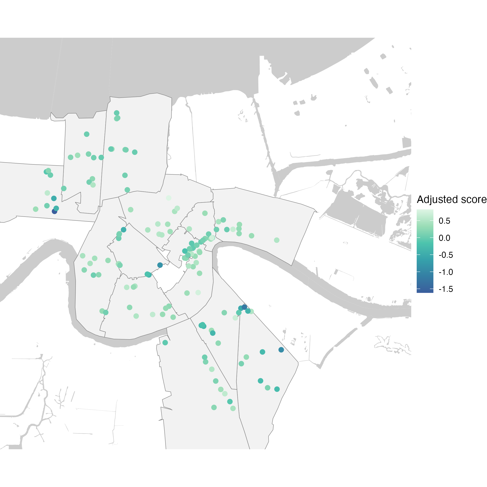

## Research question

What restaurants in New Orleans are best for a tourist family that includes picky eaters?

Answer in the tables and map below. The tables show the 10 best candidates for picky eaters in each of the 7 ZIP codes containing the most candidates; the restaurants in all 14 ZIPs with at least 10 candidates are plotted on the map below.

::: panel-tabset
```{r answer}
#| results: asis
top10_file <- "data/LA/top10.rds"
if (file.exists(top10_file)) {
  top10_saved <- readRDS(top10_file)
  for (z in unique(top10_saved$area_id)) {
    cat("\n\n#### ", z, "\n\n")
    top10_saved[top10_saved$area_id == z, c("rank", "name", "address", "raw_mean", "adj_score")] |>
      knitr::kable(digits = 2, row.names = FALSE,
                   col.names = c("Rank", "Restaurant", "Address", "Raw mean", "Adjusted score")) |>
      cat(sep = "\n")
  }
}
```
:::



## Setup

```{r setup}
library(tidyverse)
library(lubridate)
library(sf)
library(tigris)
library(scales)
library(viridis)
library(ggspatial)
library(prettymapr)
library(leaflet)
library(shadowtext)
library(ggrepel)
source("R/config.R")

options(tigris_use_cache = TRUE)

business <- readRDS(business_out)
reviews  <- readRDS(no_text_out) |>
  mutate(date = ymd_hms(date))
# users <- readRDS(user_out)
# reviewer_reviews <- readRDS(reviewer_reviews_out)
```

## Large-data management

The Yelp review file is about 5 GB of newline-delimited JSON, too large to open comfortably in a normal R session.

- **Download and extraction:** I downloaded the Yelp Open Dataset archive from <https://business.yelp.com/data/resources/open-dataset/> and extracted it, and the .tar inside, with macOS’s built-in Archive Utility and placed the two JSON files used in this project (`yelp_academic_dataset_business.json` and `yelp_academic_dataset_review.json`) in `data/raw/`.
- **Storage:** the raw JSON files live in `data/raw/`, which is not committed to GitHub. Filtered outputs live in `data/LA/`.
- **Import:** `jsonlite::stream_in()` reads the file in chunks of 100,000 reviews. A handler function filters each chunk to Louisiana restaurants before keeping it, so memory use stays low. Parsing the full file took about 355 seconds. For the reviewers, the handler filtered out friends, which was most of the data. Parsing that file took about 186 seconds.
- **Caching:** the filtered result is saved as an RDS file, a compressed binary format that reads in seconds. Later runs use this filtered data instead of the entire dataset.
- **GitHub limits:** the filtered reviews with text were 131 MB as RDS, above GitHub's 100 MB file limit. The repository includes a version without the `text` column instead.
- **Problems and fixes:** The closest thing to a problem I experienced was the length of time that the import took, which was about 6 minutes. I did not consider it necessary to try to make it faster.

```{r import-code1}
#| file: R/import.R
#| eval: false
```

```{r import-code2}
#| file: R/picky_search.R
#| eval: false
```

## Data overview

The import keeps every Louisiana business in Yelp’s “Restaurants” category and all of their reviews, summarized in the table. I included the whole state for several reasons: to include the entire study area (since parishes are not included in the dataset); possibly more reviews per reviewer for the normalization; so that it will be easier to rerun the project for another area.

```{r overview}
tibble(
  Measure = c("Louisiana restaurants", "Reviews of those restaurants",
              "Distinct reviewers", "Earliest review", "Latest review"),
  Value = c(comma(nrow(business)), comma(nrow(reviews)),
            comma(n_distinct(reviews$user_id)),
            format(min(reviews$date), "%B %Y"), format(max(reviews$date), "%B %Y"))
) |>
  knitr::kable(align = c("l", "r"))
```

## Study area

The study area is the New Orleans tourist core and surrounding area, so I select restaurants within about 6 miles of the main tourist district of New Orleans, the French Quarter. The study area then includes New Orleans City Park, which contains the New Orleans Museum of Art and the Louisiana Children's Museum, both places that families are likely to visit.

I determined the study area by locating the French Quarter on Google Earth and using the measuring tool to visualize a radius of about 5-6 miles or 8000-10000 meters. That distance was based on the maximum amount of time my own family is typically willing to drive in a metro area in order to find a restaurant that works for all of us (about 30 minutes). I confirmed the approximate travel time by getting directions to ten or so locations around the study area in Google Maps with a "leave at" time of 4:30 pm from Jackson Square in the heart of the French Quarter.

The map below shows the study area. Zoom or drag to explore. Hover over the dots on the map to see the restaurants.

```{r study-area}
# For NOLA, the center is Jackson Square, the heart of the French Quarter
center   <- st_sfc(st_point(c(center_lon, center_lat)), crs = 4326)

restaurants <- business |>
  filter(
    !is.na(latitude), !is.na(longitude)
  ) |>
  st_as_sf(coords = c("longitude", "latitude"), crs = 4326, remove = FALSE) |>
  st_filter(center, .predicate = st_is_within_distance, dist = radius_m) |>
  st_drop_geometry()

tibble(
  Measure = c("Louisiana restaurants", "Study area restaurants"),
  Count = c(nrow(business), nrow(restaurants))
) |>
  knitr::kable(format.args = list(big.mark = ","))

center_xy <- st_coordinates(center)

leaflet() |>
  addTiles() |>
  addCircles(lng = center_xy[, "X"], lat = center_xy[, "Y"], radius = radius_m,
             fill = FALSE, color = "red", weight = 2) |>
  addCircleMarkers(data = restaurants, lng = ~longitude, lat = ~latitude,
                   radius = 2, stroke = FALSE, fillOpacity = 0.5,
                   label = ~name) |>
  addMarkers(lng = center_xy[, "X"], lat = center_xy[, "Y"], label = "Jackson Square")
```

I included only restaurants with at least `r min_biz_reviews` reviews, because averages from a handful of reviews are unreliable.

```{r all-reviewer}
all_reviewer_summary <- reviews |>
  semi_join(restaurants, by = "business_id") |>
  summarize(
    n_reviews  = n(),
    raw_mean   = mean(stars),
    raw_median = median(stars),
    .by = business_id
  ) |>
  filter(n_reviews >= min_biz_reviews)
```

## Picky-eater search

`picky_search.R` pulls restaurant reviews containing phrases likely to indicate that a restaurant is good for picky eaters, collects a 200-character snippet from each review containing each phrase, and exports 50 random snippets per phrase. I manually marked whether each snippet seemed to indicate that the restaurant did work for a picky eater, then used the resulting table to choose phrases that are actually relevant to picky eaters.

I was surprised at how useless most of the phrases turned out to be. Even "picky eater" had far fewer relevant hits than I was expecting. But it does make sense that "picky kid" would be more relevant; I'd expect parents to be more likely to mention in a review the unusual event that a restaurant works for their picky kids than to mention the common one (that it doesn't). For this reason and because there were not many mentions of key phrases in the data, I added some categories by hand in the category analysis (American (Traditional), Barbeque, Burgers, Diners, Fast Food, Italian, Mexican, Pizza, and Southern). I also chose not to restrict the search based on the number of reviews a particular Yelp user had given. (See [Normalized reviewer scores](#normalized-reviewer-scores), below.)

Because the research question is about families, and because there were so many unhelpful reviews using the next-most-relevant phrase ("picky eater"), I use a threshold of 0.8 for the precision cutoff, which keeps only the phrase "picky kid" as a guide to find the most likely candidates for a good restaurant.

```{r picky-search}
# Picky-eater signals: review phrases (checked by hand) compared with Yelp attributes.
# Needs: config.R (out_dir, picky_out, min_biz_reviews), business, restaurants, reviews.

picky <- readRDS(picky_out)

# 1. Precision of each phrase, from the hand-labeled sample
picky_sample <- read_csv(file.path(out_dir, "picky_sample.csv"), show_col_types = FALSE) |>
  mutate(relevant = str_to_lower(str_trim(relevant)))   # "Y " and "y" count the same

precision <- picky_sample |>
  group_by(phrase) |>
  summarize(
    checked    = sum(!is.na(relevant)),
    n_relevant = sum(relevant == "y", na.rm = TRUE),
    precision  = n_relevant / checked
  ) |>
  left_join(count(picky, phrase, name = "total_matches"), by = "phrase") |>
  arrange(desc(precision))

precision |>
  mutate(precision = percent(precision, accuracy = 1)) |>
  knitr::kable(col.names = c("Phrase", "Checked", "Relevant", "Precision", "Total matches"), 
               align = c("l", "r", "r", "r", "r"))

precision_cutoff <- 0.8
keep_phrases <- precision |> filter(precision >= precision_cutoff) |> pull(phrase)

# 2. Yelp attributes for study-area restaurants
clean_attr <- function(x) {
  x <- str_remove_all(x, "^u?'|'$")   # u'casual' and 'casual' both become casual
  na_if(x, "None")
}

attrs <- business |>
  semi_join(restaurants, by = "business_id") |>
  select(business_id, attributes) |>
  unpack(attributes) |>
  mutate(
    across(-business_id, clean_attr),
    gfm_known      = str_detect(GoodForMeal, "True"),   # all False is treated as unknown
    good_breakfast = if_else(gfm_known, str_detect(GoodForMeal, "'(breakfast|brunch)': True"), NA),
    good_lunch     = if_else(gfm_known, str_detect(GoodForMeal, "'lunch': True"), NA),
    good_dinner    = if_else(gfm_known, str_detect(GoodForMeal, "'dinner': True"), NA)
  )

# GoodForMeal: TRUE = at least one meal flagged, FALSE = all False, NA = missing
# count(attrs, gfm_known)

# 3. Picky-mention rate per restaurant
picky_biz <- picky |>
  filter(phrase %in% keep_phrases) |>
  distinct(business_id, user_id, date) |>   # a review matching several phrases counts once
  count(business_id, name = "picky_reviews")

picky_rate <- all_reviewer_summary |>
  select(business_id, n_reviews) |>
  left_join(picky_biz, by = "business_id") |>
  mutate(
    picky_reviews = replace_na(picky_reviews, 0L),
    picky_rate    = picky_reviews / n_reviews
  ) |>
  left_join(attrs, by = "business_id")

# 4. Compare the rate with the attributes
check_attrs <- c("GoodForKids", "RestaurantsGoodForGroups", "NoiseLevel", "RestaurantsPriceRange2")

picky_rate |>
  select(picky_reviews, picky_rate, all_of(check_attrs)) |>
  pivot_longer(all_of(check_attrs), names_to = "attribute", values_to = "value") |>
  group_by(attribute, value) |>
  summarize(
    restaurants = n(),
    share_any   = mean(picky_reviews > 0),
    mean_rate   = mean(picky_rate),
    .groups = "drop"
  ) |>
  mutate(across(c(share_any, mean_rate), \(x) percent(x, accuracy = 0.01))) |>
  knitr::kable(col.names = c("Attribute", "Value", "Restaurants",
                             "Share with any mention", "Mean mention rate"),
               align = c("l", "l", "r", "r", "r"))
```

## Restaurant categories

```{r cat-calc}
rest_cats <- restaurants |>
  select(business_id, categories) |>
  separate_longer_delim(categories, delim = ", ") |>
  rename(category = categories) |>
  mutate(category = str_squish(category))

# Capitalization check - maintain capitalization for plots and tables.
# stop if any category appears with different capitalization
stopifnot(
  rest_cats |>
    distinct(category) |>
    count(lower = str_to_lower(category)) |>
    filter(n > 1) |>
    nrow() == 0
)

# overall rate of picky eater reviews. Initial threshold for choosing categories.
overall_rate <- sum(picky_rate$picky_reviews) / sum(picky_rate$n_reviews)
# manual override of the threshold, to reduce the number of categories:
picky_mention_cutoff <- 0.2 / 1000

# use that threshold to choose categories for picky eaters:
cat_signals <- picky_rate |>
  inner_join(rest_cats, by = "business_id") |>
  group_by(category) |>
  summarize(
    restaurants  = n(),
    mentions     = sum(picky_reviews),
    mention_rate = sum(picky_reviews) / sum(n_reviews)
  ) |>
  filter(restaurants >= 20)

# explicitly excluded categories
excluded_cats <- c("Sports Bars")

# categories chosen by the mention-rate rule
rule_cats <- cat_signals |>
  filter(mention_rate > picky_mention_cutoff, mentions >= 3,
         !category %in% excluded_cats) |>
  pull(category)

# add categories generally expected to be good for picky eaters
added_cats <- c("American (Traditional)", "Barbeque", "Burgers", "Diners",
                "Fast Food", "Italian", "Mexican", "Pizza", "Southern")

# candidate categories
candidate_cats <- union(rule_cats, added_cats)

# restaurant-level filters (independent of category)
# restaurants marked not good for kids; missing values are kept
not_for_kids <- attrs |> filter(GoodForKids == "False") |> pull(business_id)

# eligible restaurants are operational and not marked as not good for kids.
# they also must have enough reviews
eligible <- restaurants |>
  filter(is_open == 1, !business_id %in% not_for_kids) |>
  semi_join(all_reviewer_summary, by = "business_id")

# co-occurrence among candidate categories, eligible restaurants only
cand  <- rest_cats |>
  filter(category %in% candidate_cats) |>
  semi_join(eligible, by = "business_id")
sizes <- count(cand, category, name = "n_cat")

# candidate categories' Jaccard values
overlap <- cand |>
  inner_join(cand, by = "business_id", relationship = "many-to-many") |>
  count(cat_a = category.x, cat_b = category.y, name = "shared") |>
  left_join(rename(sizes, cat_a = category, n_a = n_cat), by = "cat_a") |>
  left_join(rename(sizes, cat_b = category, n_b = n_cat), by = "cat_b") |>
  mutate(jaccard = shared / (n_a + n_b - shared))

# keep candidates related to at least one other candidate
selected_cats <- overlap |>
  filter(cat_a != cat_b) |>
  group_by(cat_a) |>
  summarize(max_jaccard = max(jaccard)) |>
  filter(max_jaccard >= 0.05) |>
  pull(cat_a)

# exclusions table with reasons
exclusions <- tribble(
  ~business_id,                ~name,                         ~reason,
  "YIWBvaCSeIKLcXAQWkvz9w",   "Bonafried",                    "Food truck with no address",
  "_C7QiQQc47AOEv4PE3Kong",   "Commander's Palace",           "Formal dining with dress code",
  "UmjITdXHhEF46ho6IhaGQg",   "Dave & Buster's",              "Arcade and sports bar",
  "nGYXglmKHgUcovuTHIg6_A",   "Food Drunk Food Truck",        "Food truck with no address",
  "nk96iwJV1_p2HECYQW1ysA",   "French Quarter Phantoms",      "Tour company, not a restaurant",
  "yvh5qUSAbjMnvYy_HrATdQ",   "Hooters",                      "Adult-oriented bar",
  "OyF6c2he3Aej9itlH8oz-A",   "Jewel of the South",           "Cocktail bar; not good for picky eaters",
  "9kv9JpLhzkN3UeWZDrsmEA",   "The Country Club",             "Adult-oriented venue and bar",
  "girDKh9waA2VA81x4h02Lw",   "Main Squeeze Juice Co.",       "Juice bar",
  "PPow3qO48buSNaEkQ_us_w",   "Nola Mia Gelato Cafe",         "Dessert place",
  "2Sgt5ekJ7F785czScIZEYg",   "Piccola Gelateria",            "Dessert place",
  "aWrfoWJFBVQcgMVaD6Bvyw",   "Stop Jockin Snoballs",         "Dessert place"
)

# candidate restaurants
picky_group <- eligible |>
  semi_join(filter(rest_cats, category %in% selected_cats), by = "business_id") |>
  anti_join(exclusions, by = "business_id")

dropped_cats <- setdiff(candidate_cats, selected_cats)
dropped_text <- if (length(dropped_cats) > 0) str_flatten_comma(dropped_cats) else "none"
```

I kept businesses with "Restaurants" in their category list, trimmed extra whitespace from category names, and ensured all categories have consistent capitalization. I then chose categories in three steps:

1.  I selected categories with at least 20 restaurants with `r min_biz_reviews` or more reviews, at least 3 mentions of "picky kid" in the reviews, and more than `r picky_mention_cutoff * 1000` such reviews per 1000. I chose the last cutoff to reduce the number of categories to a manageable level. Additionally, because Sports Bars are generally not good for families, I excluded that category.

2.  Some types of restaurants are often expected to be good for picky eaters, and therefore would be unlikely to be mentioned as such in reviews -- I would expect the opposite, that such reviews mentioning picky eaters would more likely be complaints. I therefore included `r str_flatten_comma(added_cats)` categories despite their low mention rate in the analysis.

3.  Categories that share many restaurants describe similar places. I kept a candidate if its Jaccard overlap (restaurants in both categories divided by restaurants in either) with at least one other candidate was 0.05 or more.

The final selection is `r str_flatten_comma(sort(selected_cats))`. Of these, `r str_flatten_comma(sort(intersect(selected_cats, rule_cats)))` came from the “picky kid” search.

A restaurant is a candidate if it is open, is not marked by Yelp as not good for kids (restaurants with no value for that attribute are kept), has at least `r min_biz_reviews` reviews, belongs to at least one of the selected categories, and is not on the exclusion list below. `r nrow(picky_group)` restaurants in the study area meet these criteria.

I removed `r nrow(exclusions)` businesses by hand that matched a selected category but do not fit the question: businesses that are not restaurants, food trucks with no address, bars and adult-oriented venues, formal dining, and places that serve only desserts or juice.

```{r exclusions-table}
exclusions |>
  select(name, reason) |>
  knitr::kable(col.names = c("Restaurant", "Reason removed"))
```

The tabs below show each category’s mention rate (selected categories are right of the dashed line or added by judgment), the overlap among candidates (color is the Jaccard value, numbers are shared restaurants, and the diagonal is each category’s size), and the 10 most-overlapping pairs.

::: panel-tabset
#### Picky-kid mentions by category

```{r mention-plot}
#| fig-height: 12
#| fig-width: 10
# plot picky-kid mentions by category
cat_signals |>
  mutate(
    category = fct_reorder(category, mention_rate),
    selected = case_when(
      category %in% rule_cats  ~ "Selected by rule",
      category %in% added_cats ~ "Added by judgment",
      .default = "Not selected"
    )
  ) |>
  ggplot(aes(mention_rate * 1000, category, color = selected, size = restaurants)) +
  geom_point() +
  geom_vline(xintercept = picky_mention_cutoff * 1000, linetype = "dashed") +
  labs(x = "'Picky kid' mentions per 1,000 reviews", y = NULL,
       color = NULL, size = "Restaurants")
```

#### Category overlap

```{r overlap-heatmap}
#| fig-height: 8
#| fig-width: 9
# order the categories
cat_order <- sizes |> arrange(desc(n_cat)) |> pull(category)

# heatmap: color = overlap, label = shared restaurants, diagonal = category size
overlap |>
  mutate(diag    = cat_a == cat_b,
         jaccard = if_else(diag, NA, jaccard),
         cat_a   = factor(cat_a, levels = cat_order),
         cat_b   = factor(cat_b, levels = cat_order)) |>
  filter(as.integer(cat_a) <= as.integer(cat_b)) |>   # lower triangle plus diagonal
  ggplot(aes(cat_a, cat_b, fill = jaccard)) +
  geom_tile(color = "white") +
  geom_text(aes(label = shared, color = diag), size = 3) +
  scale_color_manual(values = c(`TRUE` = "black", `FALSE` = "white"), guide = "none") +
  scale_fill_viridis_c(option = "mako", begin = 0.4, na.value = "grey90") +
  coord_fixed() +
  scale_y_discrete(limits = rev) +
  labs(x = NULL, y = NULL, fill = "Overlap\n(Jaccard)") +
  theme_minimal() +
  theme(axis.text.x = element_text(angle = 45, hjust = 1),
        panel.grid = element_blank())
```

#### Most-overlapping pairs

```{r overlap-table}
# Jaccard table: each pair once, most overlap first
overlap |>
  filter(cat_a < cat_b) |>
  arrange(desc(jaccard)) |>
  slice_head(n = 10) |>
  select(cat_a, cat_b, shared, jaccard) |>
  knitr::kable(digits = 2,
               col.names = c("Category", "Category", "Shared restaurants", "Jaccard"))
```
:::

## Geographic systems

The most relevant geographically-related question for a family looking for a meal is how long it will take to get there. Because travel times depend on factors far outside the scope of this project, I use distance as a proxy. I compare two ways to do this: 1. zero in on a particular area and look at restaurants there, and 2. look at restaurants within a certain distance from the center of the study area.

### Boundary systems

I compare three boundary systems: census tracts and ZIP code tabulation areas from the US Census Bureau, and Neighborhood Statistical Areas from the City of New Orleans. Each restaurant point is assigned to a boundary with a spatial join, and I keep only the boundaries that touch the study area. The neighborhood boundaries cover only Orleans Parish, so restaurants elsewhere in the study area, such as Metairie, have no neighborhood. The table below counts them as unmatched.

```{r boundaries}
#| message: false
circle <- st_buffer(center, radius_m)

group_sf <- picky_group |>
  filter(!is.na(latitude)) |>
  st_as_sf(coords = c("longitude", "latitude"), crs = 4326, remove = FALSE)

tracts_sf <- tracts(area_state, cb = TRUE, year = 2022) |>
  st_transform(4326) |>
  select(area_id = starts_with("GEOID")) |>
  st_filter(circle, .predicate = st_intersects)

zips_sf <- zctas(cb = TRUE, starts_with = zcta_prefixes, year = 2020) |>
  st_transform(4326) |>
  select(area_id = starts_with("GEOID")) |>
  st_filter(circle, .predicate = st_intersects)

if (!file.exists(nsa_file)) {
  st_read(nsa_url, quiet = TRUE) |>
    st_transform(4326) |>
    select(area_id = GNOCDC_LAB) |>
    st_write(nsa_file)
}

nsa_sf <- st_read(nsa_file, quiet = TRUE) |>
  st_filter(circle, .predicate = st_intersects)

systems <- list(
  "Census tract" = tracts_sf,
  "ZIP code"     = zips_sf,
  "Neighborhood" = nsa_sf
)

# assign each restaurant to the area that contains it, one table per system
joined <- map(systems, \(polys) st_join(group_sf, polys, join = st_within, left = FALSE))
by_zip <- joined[["ZIP code"]]   # later chunks use by_zip

# restaurant count for every area, including empty ones
all_counts <- map2(systems, joined, \(polys, j) {
  polys |> left_join(j |> st_drop_geometry() |> count(area_id), by = "area_id")
}) |>
  bind_rows(.id = "system") |>
  mutate(n = replace_na(n, 0))

# number of restaurants in 70130
n_70130     <- sum(by_zip$area_id == "70130")
share_70130 <- percent(n_70130 / nrow(by_zip))

# shared size categories and colors for both bar charts
size_breaks <- c(-Inf, 0, 4, 9, 20, 50, Inf)
size_labels <- c("0", "1–4", "5–9", "10–20", "21–50", "51 or more")
size_colors <- c(
  Unmatched = "grey70",
  setNames(mako(length(size_labels), begin = 0.4, direction = -1), size_labels)
)

counts_df <- all_counts |>
  st_drop_geometry() |>
  mutate(size = cut(n, size_breaks, labels = size_labels))

# comparison table
counts_df |>
  group_by(system) |>
  summarize(
    areas      = n(),
    areas_with = sum(n > 0),
    median_n   = median(n[n > 0]),
    smallest   = min(n[n > 0]),
    largest    = max(n),
    under_5    = sum(n > 0 & n < 5),
    unmatched  = nrow(group_sf) - sum(n)
  ) |>
  knitr::kable(
    col.names = c(
      "Geographic system", "Areas in system", "Areas with restaurants",
      "Median restaurants per area", "Smallest count", "Largest count",
      "Areas under 5", "Unmatched restaurants"
    ),
    format.args = list(big.mark = ",")
  )

# choropleth
bb1 <- st_bbox(st_buffer(circle, 1500))

roads_sf <- map(parishes, \(p) roads(area_state, p, year = 2022)) |>
  bind_rows() |>
#  filter(MTFCC %in% c("S1100", "S1200")) |>
  st_transform(4326) |>
  st_crop(bb1)

water_sf <- map(parishes, \(p) area_water(area_state, p, year = 2022)) |>
  bind_rows() |>
  st_transform(4326) |>
  st_crop(bb1)

boundary_map <- function(sys, label_ids = NULL) {
  counts <- filter(all_counts, system == sys)
  ggplot(counts) +
    geom_sf(data = water_sf, fill = "grey80", color = NA) +
    geom_sf(data = roads_sf, color = "grey80", linewidth = 0.1) +
    geom_sf(aes(fill = n), alpha = 0.6, color = "white", linewidth = 0.1) +
    geom_sf(data = circle, fill = NA, color = "red") +
    (if (!is.null(label_ids)) ggrepel::geom_text_repel(
      data = filter(counts, area_id %in% label_ids),
      aes(label = area_id, geometry = geometry),
      stat = "sf_coordinates",
      size = 4.5, color = "white", bg.color = "black", bg.r = 0.15,
      max.overlaps = Inf, min.segment.length = 0
    )) +
    coord_sf(xlim = bb1[c("xmin", "xmax")], ylim = bb1[c("ymin", "ymax")], expand = FALSE) +
    scale_fill_viridis_c(option = "mako", begin = 0.4,
                         limits = c(0, max(all_counts$n))) +
    labs(fill = "Restaurants",
         caption = "Roads and water: US Census Bureau TIGER/Line") +
    theme_void()
}
```

The maps below show the system boundaries as white lines, with the study area outlined in red. The first tab shows the census tracts; the second shows neighborhoods, including that they do not cover the entire study area; the third shows the 14 ZIP codes that have at least 10 restaurants that meet the study criteria.

::: panel-tabset
#### Census tracts

```{r}
#| fig-height: 7
boundary_map("Census tract")
```

#### Neighborhoods

```{r}
#| fig-height: 7
boundary_map("Neighborhood")
```

#### ZIP codes

```{r}
#| fig-height: 7
boundary_map("ZIP code", label_ids = c("70001", "70005", "70053", "70056", "70058", "70112",
                                       "70115", "70116", "70117", "70118", "70119", "70124",
                                       "70125", "70130"))
```
:::

These two charts show the differences between the three systems. The first tab shows the number of areas per system; observe the enormous number of census tracts compared to neighborhoods or ZIP codes, and that most of them hold fewer than 10 restaurants each.

The second tab shows, per system, how many restaurants fall into areas of each size. Also note the number of restaurants not located in any New Orleans neighborhood.

If a tourist family picks an area by ZIP code, they're likely to have many more choices than if they were to look by census tract or neighborhood. The trade-off is that ZIP codes are generally larger areas, so some choices will be farther away.

::: panel-tabset
#### Areas by size

```{r}
counts_df |>
  count(system, size, name = "areas") |>
  ggplot(aes(system, areas, fill = size)) +
  geom_col() +
  scale_fill_manual(values = size_colors) +
  labs(x = "Boundary system", y = "Number of areas", fill = "Restaurants\nper area") +
  theme_minimal() +
  theme(axis.title.x = element_text(margin = margin(t = 10)))
```

#### Restaurants by area size

```{r}
counts_df |>
  filter(n > 0) |>
  group_by(system, size) |>
  summarize(restaurants = sum(n), .groups = "drop") |>
  bind_rows(
    counts_df |>
      group_by(system) |>
      summarize(size = "Unmatched", restaurants = nrow(group_sf) - sum(n))
  ) |>
  mutate(size = factor(size, levels = c("Unmatched", size_labels))) |>
  ggplot(aes(system, restaurants, fill = size)) +
  geom_col() +
  scale_fill_manual(values = size_colors) +
  labs(x = "Boundary system", y = "Number of restaurants", fill = "Restaurants\nper area") +
  theme_minimal() +
  theme(axis.title.x = element_text(margin = margin(t = 10)))
```
:::

### Localized areas vs concentric rings

The boxplot shows how much distance each ZIP mixes together; the ring density plot shows how restaurants thin out with distance. ZIPs are recognizable to a reader, even if they don't know exactly what area each one covers. Rings measure distance consistently, but only around a certain point.

```{r zip-dist}
# one row per restaurant, with distance from Jackson Square in km
rest_dist <- by_zip |>
  mutate(dist_km = as.numeric(st_distance(geometry, center)) / 1000) |>
  st_drop_geometry()

zip_dist <- rest_dist |>
  group_by(area_id) |>
  summarize(n = n(), median_dist_km = median(dist_km))
```

::: panel-tabset
#### Spread of distances

```{r dist-spread}
# Spread of distances within each ZIP, ordered by median
rest_dist |>
  mutate(area_id = fct_reorder(area_id, dist_km, .fun = median)) |>
  ggplot(aes(dist_km, area_id)) +
  geom_boxplot() +
  labs(x = "Distance from Jackson Square (km)", y = "ZIP code")
```

#### Median distance and restaurant count

```{r med-dist}
zip_dist |>
  mutate(area_id = fct_reorder(area_id, median_dist_km)) |>
  ggplot(aes(median_dist_km, area_id, size = n)) +
  geom_point() +
  labs(x = "Median distance from Jackson Square (km)",
       y = "ZIP code", size = "Restaurants")
```
:::

```{r rings}
n_rings <- 8

# ring boundaries: quantiles of distance, so each ring holds about the same number of restaurants
breaks <- quantile(rest_dist$dist_km, probs = seq(0, 1, length.out = n_rings + 1))
breaks[1] <- 0   # the innermost ring starts at the center

ring_summary <- rest_dist |>
  mutate(ring = cut(dist_km, breaks, include.lowest = TRUE)) |>
  count(ring) |>
  mutate(r_in = head(breaks, -1),
         r_out = tail(breaks, -1),
         area_km2 = pi * (r_out^2 - r_in^2),
         density = n / area_km2)

ggplot(ring_summary, aes(ring, density)) +
  geom_col() +
  labs(x = "Distance band from Jackson Square (km)",
       y = "Restaurants per square km") +
  theme(axis.text.x = element_text(angle = 45, hjust = 1))

# number of zip codes with at least 10 restaurants in the selected category group
n_areas <- by_zip |> st_drop_geometry() |> count(area_id) |> filter(n >= 10) |> nrow()
```

### Final geographic choice

For the localized area system, I chose to use ZIP codes with distance from the French Quarter:

- The census tracts were too numerous, and most held too few restaurants, to be of use.

- I rejected the neighborhoods option due to many restaurants being outside of New Orleans city/parish limits; some of the other cities contained so many restaurants that I would have to pull neighborhoods for each city to (possibly) make the system useful.

- A family is likely to visit multiple places around New Orleans, possibly several miles from the French Quarter. Concentric rings around a single point are only better if the family will be near that point before or after dinner. Grouping restaurants by ZIP code allows the user to choose an area near them, wherever they are in the city.

The selected category group has at least 10 likely candidate restaurants for picky eaters in each of **`r n_areas`** different areas, which meets the requirement of at least 7 areas.

## Normalized reviewer scores {#normalized-reviewer-scores}

Each reviewer has their own baseline. Some reviewers rate everything highly and others rarely give five stars. To adjust for this, I compared each review with that reviewer's own average rating across their reviews of restaurants in the category group.

The normalized score of a review is its stars minus the reviewer's mean. A positive score means the reviewer liked the restaurant more than their average; a negative score means they liked it less.

I excluded reviewers with fewer than `r min_user_reviews` reviews of category-group restaurants, because few ratings cannot establish a baseline. The table below shows the trade-off for different thresholds. At the 5-review threshold, 2,950 reviewers (3.32%) wrote 20.1% of the reviews; 413 restaurants can still be scored (only one fewer than a threshold of 3 reviews per reviewer). Less than 1% of reviewers wrote 10 or more reviews each, reducing the number of reviewers to 838 and the number of restaurants to be scored to 391.

Overall, reducing the threshold does not appreciably change the results. *Increasing* the threshold to 10 removes 22 restaurants (5.3%) from consideration, which could make a slight difference in the final result, but a tourist family would still have plenty of options in the New Orleans area.

```{r reviewer-threshold}
category_reviews <- reviews |>
  semi_join(picky_group, by = "business_id")

reviewer_n <- count(category_reviews, user_id, name = "n_user")

map(c(2, 3, 5, 6, 7, 8, 9, 10), \(k) {
  active <- filter(reviewer_n, n_user >= k)
  active_reviews <- semi_join(category_reviews, active, by = "user_id")
  tibble(
    Threshold            = k,
    Reviewers            = nrow(active),
    `Share of reviewers` = nrow(active) / nrow(reviewer_n),
    `Share of reviews`   = nrow(active_reviews) / nrow(category_reviews),
    `Restaurants scored` = active_reviews |>
      count(business_id) |>
      filter(n >= min_active_reviews) |>
      nrow()
  )
}) |>
  list_rbind() |>
  mutate(across(starts_with("Share"), percent)) |>
  knitr::kable(format.args = list(big.mark = ","), align = "r")
```

The table below shows the effect of the normalization by mean and by median on a sample of individual reviews.

```{r reviewer-baselines}
# adjust each review based on the reviewer's baseline
adjusted <- category_reviews |>
  left_join(
    summarize(category_reviews,
              user_mean = mean(stars), user_median = median(stars), user_n = n(),
              .by = user_id),
    by = "user_id"
  ) |>
  filter(user_n >= min_user_reviews) |>
  mutate(norm_mean   = stars - user_mean,
         norm_median = stars - user_median)

# seed for slice
set.seed(1)
# show a sample in a table
adjusted |>
  select(stars, user_mean, user_median, user_n, norm_mean, norm_median) |>
  slice_sample(n = 10) |>
  knitr::kable(digits = 2,
               col.names = c("Review Stars", "Reviewer mean", "Reviewer median",
                             "Reviewer's reviews", "Normalized (mean)", "Normalized (median)"),
               caption = "Sample of 10 reviews with normalized scores")
```

I use each reviewer’s mean, rather than the median, as the baseline because the mean is more sensitive. A reviewer’s median is always a whole or half star; 48% of reviews landed exactly on it and scored 0. With the mean, only 6% did the same, and all of those reviews came from reviewers who gave every restaurant the same rating. These reviews therefore add no information, so I removed them from consideration.

```{r mean-median-table}
# calculate the share of normalized scores that are exactly 0 under mean and median baselines
adjusted |>
  summarize(`Mean baseline`   = mean(norm_mean == 0),
            `Median baseline` = mean(norm_median == 0)) |>
  mutate(across(everything(), percent)) |>
  knitr::kable(caption = "Share of normalized scores exactly zero", align = "r")

adjusted |>
  filter(norm_mean == 0) |>
  summarize(same_stars_every_time = n_distinct(stars) == 1, .by = user_id) |>
  count(same_stars_every_time) |>
  knitr::kable(col.names = c("Same Stars Every Review", "Number"))

adjusted <- filter(adjusted, n_distinct(stars) > 1, .by = user_id)
```

```{r restaurant-scores}
# comparison table
restaurant_scores <- adjusted |>
  summarize(n_active = n(), adj_score = mean(norm_mean), .by = business_id) |>
  filter(n_active >= min_active_reviews) |>
  inner_join(all_reviewer_summary, by = "business_id") |>
  left_join(select(picky_group, business_id, name), by = "business_id") |>
  mutate(raw_rank     = min_rank(desc(raw_mean)),
         adj_rank     = min_rank(desc(adj_score)),
         rank_change  = raw_rank - adj_rank,
         active_share = n_active / n_reviews)

score_cols <- c("Restaurant", "Number of total reviews", "Yelp total average rating (raw mean)", "Raw rank",
                "Active reviews", "Active share", "Adjusted score", "Adjusted rank")

zip_lookup <- st_drop_geometry(by_zip) |> select(business_id, area_id, address)

scored_zip <- inner_join(restaurant_scores, zip_lookup, by = "business_id")

qualified <- scored_zip |> filter(n() >= 10, .by = area_id)

n_scored_areas <- n_distinct(qualified$area_id)

score_table <- function(df) {
  df |>
    select(name, n_reviews, raw_mean, raw_rank, n_active, active_share, adj_score, adj_rank, rank_change) |>
    mutate(active_share = percent(active_share, accuracy = 1)) |>
    knitr::kable(digits = 2, col.names = c(score_cols, "Rank change"),
                 align = c("l", rep("r", length(score_cols))))
}
```

The tabs below show:

1.  the top 20 restaurants in the study group by average Yelp rating;

2.  the top 20 likely candidate restaurants for picky eaters in the study area;[^1]

3.  the biggest changes in rank after score adjustment; and

4.  a scatter plot of each restaurant's raw average stars against the reviewer-adjusted scores.

[^1]: Based on adjusted scores, not relevant phrases, since there are so few mentions of relevant phrases in the data.

The comparison shows:

- Most of the top 20 restaurants by adjusted rank, and almost all of the restaurants in the top 20 by Yelp average rating, did not change rank by more than 100.

- 11 of the top 20 restaurants by adjusted rank also were in the top 20 by Yelp average rating.

- 9 of the 20 biggest movers were ranked below 100th in both rankings.

- the restaurants with the 20 greatest changes in rank include more chains than the restaurants that ended up in the top 20 by raw Yelp average rating or by adjusted score.

- the difference between "All reviews" and "Active reviews". The share of reviews from active users swings from 5% to 58% just in the top 10 restaurants by adjusted rank (over all ZIP codes). I included it for curiosity's sake; future work could include some analysis.

(Notes: the two Waffle Houses in the third table are different locations; restaurants can share a rank if they have the same average rating or adjusted score.)

::: panel-tabset
#### Top 20 by original Yelp average rating

```{r top-unadjusted}
restaurant_scores |> slice_max(raw_mean, n = 20, with_ties = FALSE) |> score_table()
```

#### Top 20 by adjusted score

```{r top-adjusted}
restaurant_scores |> slice_max(adj_score, n = 20, with_ties = FALSE) |> score_table()
```

#### Biggest rank changes

```{r rank-changes}
restaurant_scores |> slice_max(abs(rank_change), n = 20, with_ties = FALSE) |> score_table()
```

#### Raw vs adjusted

```{r raw-vs-adjusted}
ggplot(restaurant_scores, aes(raw_mean, adj_score, size = n_active)) +
  geom_hline(yintercept = 0, color = "grey70") +
  geom_point(alpha = 0.6, color = viridis(1, begin = 0.4)) +
  labs(x = "Average stars, all reviewers",
       y = "Average normalized score, active reviewers",
       size = "Active-reviewer\nreviews")
```
:::

The majority of restaurants (273) changed rank by less than 50. Only 51 restaurants moved by more than 100. As mentioned above, there appear to be more chain restaurants among the biggest movers.

```{r movers}
# show restaurants that moved by various amounts
mover_counts <- map(c(100, 50, 25, 20, 19, 18, 17, 16, 15, 10, 5), \(k) {
  tibble(
    Threshold = k,
    Moved     = sum(abs(restaurant_scores$rank_change) >= k),
    Stable    = sum(abs(restaurant_scores$rank_change) <  k)
  )
}) |>
  list_rbind()

# plot it
mover_counts |>
  pivot_longer(-Threshold, names_to = "group", values_to = "restaurants") |>
  ggplot(aes(Threshold, restaurants, color = group)) +
  geom_line() +
  geom_point() +
  scale_color_manual(values = mako(2, begin = 0.3, end = 0.7)) +
  labs(x = "Rank change threshold (places)", y = "Restaurants", color = NULL)
```

```{r movers-restaurants}
#| include: false
# These are the restaurants that moved by more than 50 points, and those that moved by more than 100.
chain_names <- business |> count(name) |> filter(n >= 3) |> pull(name)

movers_info <- restaurant_scores |>
  left_join(select(picky_rate, business_id, picky_reviews, picky_rate,
                   price = RestaurantsPriceRange2),
            by = "business_id") |>
  left_join(select(zip_lookup, business_id, area_id), by = "business_id") |>
  left_join(select(restaurants, business_id, categories), by = "business_id") |>
  mutate(chain = name %in% chain_names, moved = abs(rank_change))

movers_info |>
  filter(abs(rank_change) > 50) |>
  arrange(desc(abs(rank_change))) |>
  select(name, rank_change, n_active, raw_mean, adj_score, chain, price,
         picky_rate, area_id, categories)

movers_info |>
  mutate(group = case_when(rank_change >  50 ~ "Moved up",
                           rank_change < -50 ~ "Moved down",
                           .default = "Stable")) |>
  summarize(restaurants   = n(),
            share_chain   = mean(chain),
            share_price_1 = mean(price == "1", na.rm = TRUE),
            median_active = median(n_active),
            median_raw    = median(raw_mean),
            mean_picky    = mean(picky_rate) * 1000,
            .by = group)

movers_info |>
  filter(!is.na(area_id)) |>
  summarize(restaurants = n(),
            moved_up    = sum(rank_change >  50),
            moved_down  = sum(rank_change < -50),
            share_moved = mean(moved > 50),
            mean_change = mean(rank_change),
            .by = area_id) |>
  filter(restaurants >= 10) |>
  arrange(desc(restaurants))
```

## Top 10 restaurants

Requiring at least `r min_active_reviews` reviews from active reviewers removed only `r nrow(zip_lookup) - nrow(semi_join(zip_lookup, restaurant_scores, by = "business_id"))` restaurant from the category group. The chart shows how many scored restaurants each ZIP code has; the `r n_scored_areas` ZIP codes with at least 10 get a top 10 list.

```{r zip-counts}
count(scored_zip, area_id) |>
  mutate(area_id = fct_reorder(area_id, n),
         has_top10 = if_else(n >= 10, "10 or more", "Fewer than 10")) |>
  ggplot(aes(n, area_id, fill = has_top10)) +
  geom_col() +
  geom_vline(xintercept = 10, linetype = "dashed") +
  scale_fill_manual(values = c("10 or more" = mako(1, begin = 0.4), "Fewer than 10" = "grey70")) +
  labs(x = "Scored restaurants", y = "ZIP code", fill = NULL)
```

```{r top10}
top10 <- qualified |>
  slice_max(adj_score, n = 10, with_ties = FALSE, by = area_id) |>
  mutate(rank = row_number(desc(adj_score)), .by = area_id)

# order restaurants in each ZIP by rank
top10 <- arrange(top10, area_id, rank)

# save results for the top-of-report summary
answer_zips <- qualified |> count(area_id, sort = TRUE) |> slice_head(n = 7) |> pull(area_id)

top10 |>
  filter(area_id %in% answer_zips) |>
  arrange(match(area_id, answer_zips), rank) |>
  saveRDS(file.path(out_dir, "top10.rds"))
```

The tabs below list the top 10 restaurants in each of the `r n_scored_areas` ZIP codes; the map at the top of the report shows where they are.

::: panel-tabset
```{r top10-tables}
#| results: asis
for (z in sort(unique(top10$area_id))) {
  cat("\n\n#### ", z, "\n\n")
  top10 |>
    filter(area_id == z) |>
    select(rank, name, address, raw_mean, adj_score) |>
    knitr::kable(digits = 2,
                 col.names = c("Rank", "Restaurant", "Address", "Raw mean", "Adjusted score")) |>
    cat(sep = "\n")
}
```
:::

```{r top10-map}
#| include: false
top10_sf <- group_sf |>
  select(business_id) |>
  inner_join(top10, by = "business_id")

# map view of top 10 restaurants in each qualifying ZIP code
top10_map <- ggplot() +
  geom_sf(data = water_sf, fill = "grey80", color = NA) +
  geom_sf(data = filter(zips_sf, area_id %in% top10$area_id),
          fill = "grey95", color = "grey50") +
  geom_sf(data = top10_sf, aes(color = adj_score), size = 2) +
  scale_color_viridis_c(option = "mako", begin = 0.4) +
  coord_sf(xlim = bb1[c("xmin", "xmax")], ylim = bb1[c("ymin", "ymax")], expand = FALSE) +
  labs(color = "Adjusted score") +
  theme_void()

ggsave("figures/top10_map.png", top10_map, width = 7, height = 7)
```

## Findings

- Useful (and useless) phrases for picky eaters looking for a place to eat:
  - "Picky kid" is the only one I found useful.
  - "Picky eater" also shows up a lot in the data, but it's too often inside phrases like "I'm not a picky eater, but the food here is terrible!"
  - Other phrases were not correlated closely enough with positive reviews related to picky eaters to be any use.
- 14 ZIP codes, covering a large portion of New Orleans and the nearby area, contained 10 or more likely candidates. This suggests a tourist family has plenty of options even if some or all of them are picky eaters.
- Adjusting for reviewer activity doesn't change most rankings much...for the most part. Looking only at the Yelp average rating is still a pretty good measure of what people actually thought about it, regardless of how many stars they tend to be willing to give on average.

## Limitations

- Yelp reviews are not a random sample of diners, and the Yelp Open Dataset is a curated dataset several years out of date.
- The import only keeps businesses with category "Restaurants", so any business that does not have that category will not be included in the analysis, even if it serves food. This is particularly applicable to breakfast and coffee shops (not currently included in the analysis).
- Reviewers analysis is also based only on reviews found in the "Restaurants" category. This can be useful if users are likely to review restaurants differently than other businesses, or detrimental because it doesn't take all of a user's reviews into account.
- ZIP code 70130, which includes a section of the French Quarter, has far more restaurants than any other ZIP. A more detailed analysis for that area (per city district, for example) would be more useful for tourists looking for something within walking distance.
- My process for determining whether a particular phrase inside a review actually corresponded with that restaurant being good for picky eaters only included a snippet of each review. A more accurate process would require significantly more time.

## Session information

```{r session}
sessionInfo()
```
